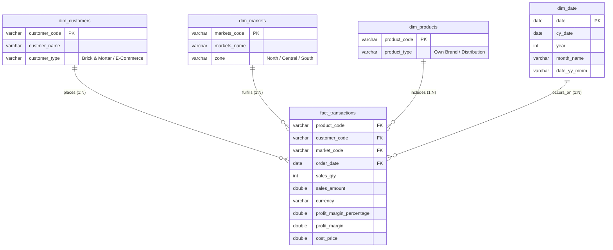

# 📊 AtliQ Hardware Sales Performance & Profitability Insights

[](https://www.mysql.com/)
[](https://powerbi.microsoft.com/)
[](https://www.python.org/)
[]()
[](LICENSE)

---

## 📌 Executive Summary

AtliQ Hardware is an India-based hardware and computer peripheral manufacturer supplying clients across multiple regional markets through both **Brick & Mortar** retail stores and **E-Commerce** platforms.

The Sales Director observed rapidly declining sales growth and eroding profit margins across various regions. Due to a reliance on anecdotal feedback from regional managers and sluggish Excel reports, leadership lacked real-time visibility into transaction-level trends, customer margins, and territory health.

This project delivers an **end-to-end data analytics and business intelligence solution** — from MySQL ETL audits and data engineering anomaly detection to interactive **Power BI Dashboards** and **Python automated exploratory analytics**.

---

## 🏗️ Data Architecture & Star Schema Model

The data warehouse architecture follows a **Star Schema** design centered on sales transactions, connecting seamlessly to dimensional tables for temporal, customer, geographical, and product-level filtering.



### 🧩 Power BI Entity Relationship Diagram (ERD)


---

## 🔍 Critical Data Quality & Engineering Audit

During deep exploratory SQL & Python analysis of the raw MySQL database dumps (`db_dump.sql` & `db_dump_version_2.sql`), **six major data anomalies** were uncovered and resolved:

| # | Anomaly / Data Quality Defect | Impact on Analysis | Engineering / ETL Resolution |
|---|-------------------------------|---------------------|------------------------------|
| **1** | **The `(Blank)` Product Mystery** | In Power BI, June 2020 grouped **₹6.81M** in sales under `(Blank)`. The `products` table only contains `Prod001` to `Prod279`, while `transactions` has records for `Prod280`–`Prod339` (**54,599 orphaned transactions** totaling **₹468.96M**). | Identified referential integrity break; documented M-Query join fix and SQL dimension backfill. |
| **2** | **Currency Discrepancies (`USD` vs `INR`)** | 2 transactions recorded in USD (`$750` total). Combining raw amounts directly artificially deflated revenue. | Applied conversion multiplier (`USD * 75`) in SQL and Power Query custom column. |
| **3** | **Trailing Carriage Returns (`\r`)** | Raw MySQL dumps contained carriage returns in strings: `'INR\r'`, `'USD\r'`, `'Own Brand\r'`, `'Distribution\r'`. | Applied `TRIM(REPLACE(column, '\r', ''))` in SQL and `Text.Clean()` in Power Query. |
| **4** | **Negative & Zero Sales Amounts** | Version 1 dump contained **1,611 invalid transactions** with `sales_amount <= 0` (e.g. `-1` and `0`). | Filtered out in ETL (`sales_amount > 0 AND sales_qty > 0`); resolved in Version 2. |
| **5** | **Duplicate Market Entries** | Bhopal existed under two different codes: `Mark007` (13,226 orders) and `Mark013` (96 orders). | Grouped by `markets_name` to unify Bhopal performance under Central zone. |
| **6** | **Ghost International Markets** | New York (`Mark097`) and Paris (`Mark999`) had blank `zone` values and zero sales transactions. | Filtered out in Power Query: `[zone] <> "" and [zone] <> null`. |

---

## 📈 Key Business Metrics & Analytical Findings

### 1. Overall Company Performance (2017 – 2020)

- **Total Net Revenue**: **₹984.87 Million**
- **Total Sales Volume**: **2,429.3K Units**
- **Total Net Profit**: **₹25.75 Million**
- **Overall Profit Margin**: **2.61%**

### 2. Year-Over-Year (YoY) Financial Trend

| Year | Transactions | Units Sold | Revenue (₹M) | Profit Margin (₹M) | Profit Margin % | Key Observations |
|:---:|:---:|:---:|:---:|:---:|:---:|---|
| **2017** | 14,557 | 234,462 | ₹92.94 | ₹3.87 | **4.16%** | Operations commenced in Q4 (Oct–Dec). Highest margin rate. |
| **2018** | 60,755 | 997,497 | ₹413.69 | ₹9.34 | **2.26%** | Peak sales year. Revenue quadrupled, but margin % dropped by ~45%. |
| **2019** | 51,712 | 847,083 | ₹336.02 | ₹10.49 | **3.12%** | Revenue declined by **-18.8%**, but profitability recovered slightly. |
| **2020** | 21,371 | 350,240 | ₹142.22 | ₹2.06 | **1.45%** | Half-year data (Jan–Jun). Hit severely by COVID-19 and margin compression. |

---

### 3. Regional & Market Profitability

| Market | Zone | Orders | Revenue (₹M) | Revenue Share | Profit (₹M) | Profit Margin % | Operational Status |
|---|:---:|:---:|:---:|:---:|:---:|:---:|---|
| **Delhi NCR** | North | 44,219 | **₹519.57** | **52.76%** | ₹13.05 | 2.51% | Core Revenue Engine |
| **Mumbai** | Central | 11,321 | **₹150.08** | **15.24%** | ₹4.87 | 3.25% | Healthy & Consistent |
| **Ahmedabad** | North | 20,035 | **₹132.31** | **13.44%** | ₹2.85 | 2.15% | High Volume, Low Margin |
| **Bhopal** | Central | 13,322 | **₹58.61** | **5.95%** | ₹2.29 | 3.90% | High Margin Hub |
| **Nagpur** | Central | 47,670 | **₹55.03** | **5.59%** | ₹1.41 | 2.57% | Large Transaction Base |
| **Kochi** | South | 4,920 | **₹18.81** | **1.91%** | ₹0.70 | 3.74% | Efficient South Market |
| **Chennai** | South | 1,028 | **₹18.04** | **1.83%** | ₹0.30 | 1.67% | Below Average Margin |
| **Kanpur** | North | 2,811 | **₹13.58** | **1.38%** | **-₹0.07** | **-0.49%** | ⚠️ Loss-Making Territory |
| **Hyderabad** | South | 2,034 | **₹7.44** | **0.76%** | ₹0.05 | 0.63% | Razor-Thin Margins |
| **Bengaluru** | South | 14 | **₹0.37** | **0.04%** | **-₹0.08** | **-20.78%** | 🚨 Severely Bleeding Cash |

---

### 4. Customer Concentration Risk (Pareto Analysis)

| Customer Name | Channel | Orders | Revenue (₹M) | Share of Total Revenue | Profit (₹M) | Margin % |
|---|---|:---:|:---:|:---:|:---:|:---:|
| **Electricalsara Stores** | Brick & Mortar | 60,998 | **₹413.33** | **41.97%** | ₹9.31 | 2.25% |
| **Electricalslytical** | E-Commerce | 7,493 | **₹49.64** | **5.04%** | ₹1.69 | 3.40% |
| **Excel Stores** | Brick & Mortar | 7,643 | **₹49.12** | **4.99%** | ₹0.68 | 1.38% |
| **Premium Stores** | Brick & Mortar | 6,804 | **₹44.96** | **4.57%** | ₹2.15 | 4.78% |
| **Nixon** | E-Commerce | 6,654 | **₹43.89** | **4.46%** | ₹1.79 | 4.07% |

> ⚠️ **Key Risk Finding**: A single customer account (**Electricalsara Stores**) accounts for **42% of company revenue**, creating extreme vulnerability to account churn or payment delays.

---

### 5. Sales Channel Comparison

| Channel | Revenue (₹M) | Revenue Contribution | Profit (₹M) | Profit Margin % | Strategic Assessment |
|---|:---:|:---:|:---:|:---:|---|
| **Brick & Mortar** | ₹744.53 | 75.60% | ₹17.28 | 2.32% | High scale, lower margin due to retailer discounts |
| **E-Commerce** | ₹240.34 | 24.40% | ₹8.47 | **3.53%** | **+52% higher profit margin** relative to retail |

---

## 🖥️ Power BI Interactive Dashboard

The dashboard provides dynamic drill-downs by Year, Month, Zone, and Customer Type.


### Dashboard Visual Breakdown:
1. **Executive KPI Cards**: Instant visibility of Total Revenue (₹15M in Jun 2020) and Sales Volume (34K units).
2. **Revenue & Quantity by Market**: Stacked bar charts ranking top performing regions (Delhi NCR, Ahmedabad, Mumbai).
3. **Monthly Revenue Trend Line**: Tracks seasonal spikes and dip points over time.
4. **Top 5 Customers & Products**: Dynamic ranking identifying VIP accounts and best-selling hardware products.

---

## 🧮 Power BI DAX Measures Reference

All business logic is encapsulated in explicit DAX measures:

```dax
-- 1. Normalized Revenue
Revenue = 
SUM('sales transactions'[norm_sales_amount])

-- 2. Sales Quantity
Sales Quantity = 
SUM('sales transactions'[sales_qty])

-- 3. Total Profit Margin
Total Profit Margin = 
SUM('sales transactions'[norm_profit_margin])

-- 4. Profit Margin %
Profit Margin % = 
DIVIDE([Total Profit Margin], [Revenue], 0)

-- 5. Revenue Contribution %
Revenue Contribution % = 
DIVIDE(
    [Revenue],
    CALCULATE([Revenue], ALL('sales products'), ALL('sales markets'), ALL('sales customers')),
    0
)

-- 6. Target Variance & Profit Status
Profit Status = 
SWITCH(
    TRUE(),
    [Profit Margin %] < 0, "🔴 Loss Making",
    [Profit Margin %] < 0.02, "🟡 Low Margin",
    "🟢 Healthy Margin"
)
```

---

## 💡 Strategic Recommendations for Executive Leadership

1. **Stem Margin Leaks in Loss-Making Territories**:
   - Immediately audit delivery, warehouse, and operational overhead in **Bengaluru (-20.8% margin)** and **Kanpur (-0.49% margin)**.
   - Re-evaluate contract terms or introduce minimum order quantities (MOQs).
2. **Diversify Customer Dependency**:
   - 42% of revenue relies on **Electricalsara Stores**. Upsell second-tier accounts (Control, Premium Stores, Surge Stores) to mitigate customer concentration risk.
3. **Accelerate E-Commerce Channel Expansion**:
   - E-Commerce yields a **3.53% margin** versus **2.32% for Brick & Mortar**. Shift promotional budget toward online platforms.
4. **Fix Catalog Referential Integrity in ERP**:
   - Ensure the product master database is synchronized with transactional POS software to prevent uncataloged product sales (`Prod280`+).
5. **Phase Out Consistently Bleeding SKUs**:
   - Discontinue or re-price products with negative margins (e.g. `Prod073` at -25% margin and `Prod084` at -18.4% margin).

---

## 📂 Project Repository Structure

```
├── README.md                              # Comprehensive Project Documentation
├── Screenshot 2025-05-19 193359.png       # Power BI Star Schema Data Model
├── Screenshot 2025-05-19 193416.png       # Power BI Sales Insights Dashboard
├── db_dump.sql                            # Initial MySQL database dump (Phase 1)
├── db_dump_version_2.sql                  # Enhanced database dump with Profit Margins (Phase 2)
│
├── sql_queries/                           # Modular SQL Analysis Scripts
│   ├── 01_data_audit_and_cleaning.sql     # Anomaly detection & ETL queries
│   ├── 02_kpi_and_business_insights.sql   # Executive metrics, market & customer SQL
│   └── 03_powerbi_dax_and_mquery.sql      # Power Query M-code & DAX formulas
│
├── scripts/                               # Python Data Pipeline & Analysis Engine
│   └── sales_analysis.py                  # In-memory ETL, verification & CSV exporter
│
└── data_exports/                          # Pre-computed Analytical CSV Datasets
    ├── yearly_performance.csv             # YoY financial trends
    ├── market_performance.csv             # Market revenues, profits & margins
    ├── customer_performance.csv           # Customer sales breakdown
    └── monthly_performance.csv            # Temporal monthly trends
```

---

## 🚀 How to Run & Reproduce Locally

### Option 1: Quick Python Analysis (No MySQL required)
Clone the repo and run the self-contained analytics script:
```bash
git clone https://github.com/Dinesh1535/-Dinesh1535-Dinesh1535-Sales-Insights-Data-Analysis-.git
cd -Dinesh1535-Dinesh1535-Sales-Insights-Data-Analysis-
python scripts/sales_analysis.py
```

### Option 2: Setup in MySQL Workbench
1. Open MySQL Workbench.
2. Go to **Server** > **Data Import**.
3. Choose `Import from Self-Contained File` and select `db_dump_version_2.sql`.
4. Click **Start Import**.
5. Execute the scripts in `sql_queries/` to verify KPIs.

### Option 3: Power BI Desktop
1. Open Power BI Desktop.
2. Select **Get Data** > **MySQL database** (Server: `localhost`, Database: `sales`).
3. Load the 5 tables: `customers`, `date`, `markets`, `products`, `transactions`.
4. Add the custom columns and DAX measures specified in [`sql_queries/03_powerbi_dax_and_mquery.sql`](sql_queries/03_powerbi_dax_and_mquery.sql).

---

## 👤 Author

**Arencheruvu Dinesh**  
- **GitHub**: [@Dinesh1535](https://github.com/Dinesh1535)  
- **Specialization**: Data Analytics, SQL, Power BI, Python, Business Intelligence  

*Constructive feedback and stars ⭐ are welcome!*
